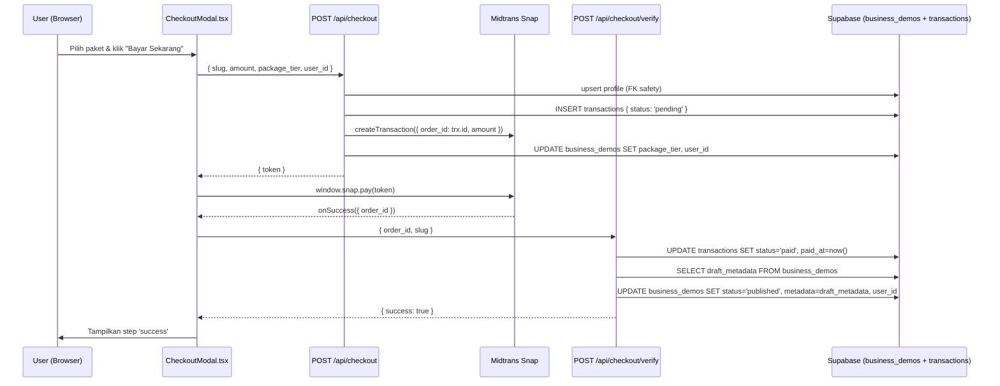

# Arsitektur Billing & Manajemen Tenant — Growfin Digital
> Status per: Oktober 2026 | Berdasarkan analisis kode `frontend/` & schema Supabase

---

## 1. Tabel `transactions` — Field vs. Implementasi Aktual

| Kolom | Status | Keterangan |
|---|---|---|
| `id` | ✅ Digunakan | UUID order dikirim ke Midtrans sebagai `order_id` |
| `user_id` | ✅ Digunakan | Di-insert saat checkout, di-resolve saat verify |
| `business_demo_id` | ✅ Digunakan | Di-resolve dari `slug` sebelum insert |
| `amount` | ✅ Digunakan | Dikirim dari frontend (harga paket yang dipilih) |
| `status` | ✅ Digunakan | `pending` → `paid` (diupdate via `/api/checkout/verify`) |
| `paid_at` | ✅ Digunakan | Di-set ke `new Date().toISOString()` saat verify |
| `payment_method` | ❌ **Tidak ditulis** | Kolom ada di schema, tidak pernah diisi di kode |
| `payment_gateway_ref` | ❌ **Tidak ditulis** | `result` dari Midtrans tidak disimpan ke DB |
| `transaction_type` | ❌ **Tidak ditulis** | Default DB `'activation'`, tidak pernah di-set secara eksplisit |
| `snapshot_tier` | ❌ **Tidak ditulis** | `package_tier` disimpan di `business_demos`, bukan di `transactions` |

---

## 2. Flow Transaksi yang Sudah Di-handle Backend



### Flow yang sudah berjalan (✅):
1. **Checkout Initiation** — Buat record `transactions` dengan status `pending`, lalu generate Midtrans Snap token.
2. **Payment Verification (Client-side triggered)** — Setelah Midtrans `onSuccess`, frontend memanggil `/api/checkout/verify` untuk menandai transaksi `paid` dan mempublikasikan website.
3. **Profile Sync** — Auto-upsert ke tabel `profiles` sebelum insert transaksi untuk menghindari FK error.
4. **Draft → Live promotion** — `draft_metadata` di-copy ke `metadata` dan `status` diubah ke `published`.
5. **Multi-tier package selection** — Frontend sudah bisa menampilkan dan memilih paket (dari `siteConfig.pricing`), dan mengirim `amount` + `package_tier` yang benar ke backend.

### ⚠️ Gap Kritikal yang Belum Ada:
- **Midtrans masih `isProduction: false`** (sandbox) → belum siap produksi.
- **Tidak ada Midtrans Webhook endpoint** (`/api/midtrans/notification`) → Verifikasi pembayaran 100% bergantung pada `onSuccess` callback di browser. Jika browser ditutup sebelum callback selesai, transaksi stuck di `pending` selamanya.
- **`payment_method` & `payment_gateway_ref` tidak disimpan** → Tidak ada audit trail metode bayar (transfer, QRIS, kartu kredit, dsb).
- **Tidak ada logika perpanjangan / renewal** → `transaction_type` hanya default `'activation'`, belum ada alur untuk paket berlangganan atau perpanjangan domain.
- **`site_active_until` & `domain_active_until`** di `business_demos` tidak pernah di-set oleh kode manapun → field ada tapi mati.

---

## 3. Fitur Super Admin Console — Status Implementasi

### ✅ Yang Sudah Ada (implisit via Supabase Service Role):
- Operasi admin (baca/tulis melewati RLS) dilakukan via `createClient(url, SERVICE_ROLE_KEY)` di seluruh API route backend.

### ❌ Yang Belum Dibuat UI-nya (Ghost Features):

| Fitur Admin | Bukti di Skema/Kode | Status UI |
|---|---|---|
| **Daftar semua transaksi** | Tabel `transactions` ada, termasuk `status`, `paid_at`, `amount` | ❌ Tidak ada halaman `/admin/transactions` |
| **Manajemen tenant/bisnis** | `business_demos` punya `status`, `package_tier`, `user_id` | ❌ Tidak ada halaman `/admin/businesses` |
| **Manajemen user/profil** | Tabel `profiles` ada | ❌ Tidak ada halaman `/admin/users` |
| **Force-publish / force-lock bisnis** | Field `status` sudah ada, tinggal UI update | ❌ Tidak ada action button di admin panel |
| **Lihat riwayat pembayaran per user** | JOIN `transactions` + `profiles` bisa dilakukan | ❌ Tidak ada |
| **Set `site_active_until` / `domain_active_until`** | Kolom ada di `business_demos` | ❌ Tidak ada UI maupun logika backend yang mengisinya |
| **Override `package_tier` manual** | Field ada | ❌ Tidak ada |
| **Dashboard analitik revenue** | `transactions.amount` + `paid_at` tersedia untuk agregasi | ❌ Tidak ada |
| **Kelola `snapshot_tier`** | Kolom ada di `transactions` untuk audit "paket apa yang dibeli saat itu" | ❌ Tidak pernah diisi |

> [!IMPORTANT]
> Tidak ditemukan satupun route atau komponen dengan prefix `/admin` atau `/super-admin` di seluruh codebase `frontend/`. Super Admin Console belum dibangun sama sekali — saat ini seluruh operasi admin dilakukan langsung via Supabase Dashboard (Table Editor).

---

## 4. Ringkasan Prioritas Teknis

```
KRITIKALITAS TINGGI
├── [Security] Tambahkan Midtrans Webhook endpoint (/api/midtrans/notification)
│   └── Validasi signature dari Midtrans, update transaksi dari server-to-server
├── [Go-Live] Ganti isProduction: false → true (setelah testing selesai)
└── [Data Integrity] Isi payment_gateway_ref & payment_method saat verify

KRITIKALITAS SEDANG
├── [Billing] Set site_active_until saat transaksi paid
├── [Billing] Logika cek expired (locked state enforcement)
└── [Admin] Bangun halaman /admin/transactions minimal (tabel read-only)

KRITIKALITAS RENDAH (Nice-to-Have)
├── [Admin] Dashboard revenue & analitik
├── [Billing] Alur renewal/perpanjangan
└── [Audit] Isi snapshot_tier saat checkout
```
