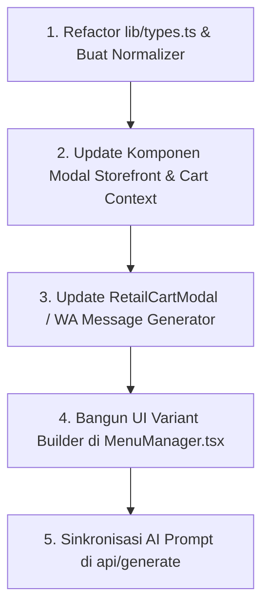

Berdasarkan audit langsung pada struktur kode saat ini, berikut adalah analisis **Technical Debt** dan checklist komprehensif (**TODO**) yang perlu dirombak di layer **Types**, **Database**, **Komponen UI**, dan **Dashboard Client** untuk mewujudkan sistem *Marketplace Cart* dengan `priceModifier`.

---

### 1. Temuan & Technical Debt Saat Ini (Kondisi Lapangan)

Saat ini implementasi varian produk di codebase memiliki beberapa hutang teknis yang cukup riskan:
1. **Hack Regex Parsing String**: Di [ProductCustomizationModal.tsx](file:///d:/Project/Growfin%20Digital/frontend/components/demo/fnb/universal/ProductCustomizationModal.tsx#L50-L55) dan [RetailQuickViewModal.tsx](file:///d:/Project/Growfin%20Digital/frontend/components/demo/retail/universal/RetailQuickViewModal.tsx#L54-L59), penambahan harga dilakukan dengan parsing regex terhadap teks label pilihan:
   ```ts
   const match = opt.match(/\(\+Rp\s*([\d.]+)\)/);
   if (match) total += parseInt(match[1].replace(/\./g, ''));
   ```
   *Masalah*: Sangat rapuh (gagal jika format tanpa titik, singkatan `+50k`, diskon minus, atau bahasa asing), tidak mendukung kupon, dan rawan bug kalkulasi.
2. **Inkonsistensi Kontrak Cart**:
   - Di [FnbDemoContext.tsx](file:///d:/Project/Growfin%20Digital/frontend/components/demo/fnb/core/FnbDemoContext.tsx#L11), state menampung `selectedVariants: Record<string, string>`.
   - Di [RetailDemoContext.tsx](file:///d:/Project/Growfin%20Digital/frontend/components/demo/retail/core/RetailDemoContext.tsx#L45), state menampung `selectedOptions?: Record<string, string>`, namun [RetailQuickViewModal.tsx](file:///d:/Project/Growfin%20Digital/frontend/components/demo/retail/universal/RetailQuickViewModal.tsx#L68) mengirim payload dengan key `selectedVariants`, menyebabkan inkonsistensi.
3. **`price` Berupa String**: Di [lib/types.ts](file:///d:/Project/Growfin%20Digital/frontend/lib/types.ts#L17), `price` pada `MenuItem` masih bertipe `string` (misal `"Rp 25.000"`), sehingga setiap komponen harus berulang kali melakukan sanitasi regex `parseInt(price.replace(/\D/g, ''))`.
4. **Dashboard Client Tidak Punya UI Varian**: Komponen [MenuManager.tsx](file:///d:/Project/Growfin%20Digital/frontend/components/dashboard/MenuManager.tsx) hanya memiliki input untuk `name`, `price`, `category`, `desc`, dan foto. Jika pemilik bisnis mengedit produk via dashboard, data `variants` dan `addons` tidak bisa diatur atau berpotensi hilang.

---

### 2. Checklist Checklist / TODO Per Layer

#### A. Perubahan pada Types & Contracts ([lib/types.ts](file:///d:/Project/Growfin%20Digital/frontend/lib/types.ts))

- [ ] **Buat Objek Opsi Varian Terstruktur (`VariantOption`)**:
  Ubah `options: string[]` menjadi array objek dengan properti harga eksplisit.
  ```ts
  export interface VariantOption {
    id?: string;
    label: string;            // Contoh: "256 GB", "XL", "Oatmilk"
    priceModifier: number;    // Contoh: 0, 1500000, 5000 (bisa positif atau minus)
    sku?: string;             // Opsional untuk inventori marketplace
  }

  export interface MenuItemVariant {
    name: string;             // Contoh: "Kapasitas Penyimpanan", "Ukuran"
    required?: boolean;       // Wajib dipilih atau tidak (default: true)
    options: VariantOption[]; // Bukan string[] lagi
  }
  ```
- [ ] **Dukung *Backward Compatibility* pada `MenuItemVariant`**:
  Jika masih ada data lama berupa `string[]`, buat type union sementara atau fungsi migrasi:
  ```ts
  options: (string | VariantOption)[];
  ```
- [ ] **Refaktor Tipe Data Harga Dasar (`MenuItem`)**:
  - Ganti `price: string` menjadi `price: number` (atau `price: number | string` secara transisi) untuk menghindari pemanggilan `replace(/\D/g, '')` di puluhan komponen.
- [ ] **Standarisasi Tipe Cart Item Universal**:
  Satukan interface cart FnB dan Retail menjadi kontrak universal:
  ```ts
  export interface SelectedVariantChoice {
    variantName: string;
    optionLabel: string;
    priceModifier: number;
  }

  export interface UnifiedCartItem {
    id: string;               // Hash unik: misal `${productId}-${variantOptionIds.join('-')}`
    product: MenuItem;
    quantity: number;
    basePrice: number;
    selectedVariants: Record<string, SelectedVariantChoice>; 
    selectedAddons: MenuItemAddon[];
    notes?: string;
    unitPrice: number;        // basePrice + total modifier varian + addons
    totalPrice: number;       // unitPrice * quantity
  }
  ```

---

#### B. Perubahan pada Database & Data Persistence

Data menu saat ini tersimpan di tabel `business_demos` dalam kolom JSONB `metadata->'menu'` dan `draft_metadata->'menu'`.

- [ ] **Runtime Adapter / Normalizer (Tanpa Perlu Migrasi SQL Berat)**:
  Buat utility normalizer di [frontend/lib/types.ts](file:///d:/Project/Growfin%20Digital/frontend/lib/types.ts) atau `lib/utils.ts` (misal: `normalizeMenuItem(raw)`):
  - Jika `options` berisi `string` yang mengandung `(+Rp 5.000)`, ekstrak ke `{ label: 'Large', priceModifier: 5000 }`.
  - Jika hanya teks murni `"Hitam"`, jadikan `{ label: 'Hitam', priceModifier: 0 }`.
  - Ini memastikan data legacy di database Supabase tidak merusak aplikasi saat dibaca di [app/demo/[slug]/page.tsx](file:///d:/Project/Growfin%20Digital/frontend/app/demo/%5Bslug%5D/page.tsx).
- [ ] **Penyesuaian Prompt Generator AI ([app/api/generate/route.ts](file:///d:/Project/Growfin%20Digital/frontend/app/api/generate/route.ts#L330))**:
  - Update instruksi Gemini AI saat men-generate JSON metadata menu agar varian menghasilkan format terstruktur:
    ```json
    "variants": [
      {
        "name": "Ukuran",
        "options": [
          { "label": "Regular", "priceModifier": 0 },
          { "label": "Large", "priceModifier": 5000 }
        ]
      }
    ]
    ```
- [ ] **Evaluasi Jangka Panjang (Skala Marketplace Nyata)**:
  - Jika bisnis berkembang menjadi marketplace multi-vendor dengan stok per varian (SKU), buat tabel terpisah di Supabase: `products`, `product_variants`, dan `variant_combinations` (relasional), alih-alih menaruh seluruh katalog di dalam satu kolom JSONB `metadata`.

---

#### C. Perubahan pada Komponen UI Storefront & Cart Context

- [ ] **Hapus Hack Regex di Modal Kustomisasi**:
  - Di [ProductCustomizationModal.tsx](file:///d:/Project/Growfin%20Digital/frontend/components/demo/fnb/universal/ProductCustomizationModal.tsx) dan [RetailQuickViewModal.tsx](file:///d:/Project/Growfin%20Digital/frontend/components/demo/retail/universal/RetailQuickViewModal.tsx):
    - Hitung total harga langsung dari nilai numerik:
      ```ts
      const variantsModifier = Object.values(selectedVariants).reduce(
        (sum, v) => sum + (v.priceModifier || 0), 0
      );
      const unitPrice = basePrice + variantsModifier + addonsTotal;
      const total = unitPrice * quantity;
      ```
- [ ] **Tampilan Badge Varian di Modal**:
  - Tampilkan label dan modifier harga secara terpisah dan rapi di UI:
    ```tsx
    <button>
      <span>{opt.label}</span>
      {opt.priceModifier > 0 && (
        <span className="text-xs text-brand-primary ml-1.5 font-semibold">
          +{formatRupiah(opt.priceModifier)}
        </span>
      )}
    </button>
    ```
- [ ] **Perbaiki Logika Deduplikasi di Cart Context ([RetailDemoContext.tsx](file:///d:/Project/Growfin%20Digital/frontend/components/demo/retail/core/RetailDemoContext.tsx#L145-L157))**:
  - Saat ini item dicek menggunakan `JSON.stringify(i.selectedOptions)`. Jika urutan key berbeda atau opsi berbeda format, deduplikasi gagal.
  - Gunakan hash ID komposit: `const cartItemId = `${product.id}-${sortedSelectedOptionsKey}`. Jika item ID sama persis, tambahkan quantity; jika berbeda varian, buat baris baru di keranjang.
- [ ] **Perbaiki Bug Render di Template Tema ([ArtisanProductGrid.tsx](file:///d:/Project/Growfin%20Digital/frontend/components/demo/retail/themes/artisan/ArtisanProductGrid.tsx#L78))**:
  - Di baris 78 terdapat kode `{p.variants?.[0] || '1 Pack'}` yang mengasumsikan varian adalah string. Jika varian berupa object, React akan melempar error. Ubah menjadi:
    `{typeof p.variants?.[0] === 'object' ? p.variants[0].name : p.variants?.[0] || '1 Pack'}`.
- [ ] **Format Pesan WhatsApp & Checkout Modal ([RetailCartModal.tsx](file:///d:/Project/Growfin%20Digital/frontend/components/demo/retail/universal/RetailCartModal.tsx#L35-L51) & [CheckoutModal.tsx](file:///d:/Project/Growfin%20Digital/frontend/components/demo/fnb/universal/CheckoutModal.tsx))**:
  - Rincikan modifier harga pada pesan WhatsApp agar transparan bagi pembeli dan kasir/admin:
    ```text
    1. iPhone 15 Pro (x1) - Rp 21.500.000
       - Storage: 256 GB (+Rp 2.000.000)
       - Warna: Titanium Alami
    ```

---

#### D. Perubahan pada Dashboard Client ([MenuManager.tsx](file:///d:/Project/Growfin%20Digital/frontend/components/dashboard/MenuManager.tsx))

- [ ] **Integrasi State Edit Varian**:
  - Tambahkan array `variants` pada `editForm` di `MenuManager`.
- [ ] **Sub-Form Builder Varian Produk**:
  - Tambahkan section *"Varian Produk (Ukuran, Warna, Memori, dll)"* di dalam modal/form edit item.
  - Tombol **"Tambah Kelompok Varian"** (misal: "Ukuran").
  - Di dalam kelompok varian, sediakan repeater untuk opsi:
    - Input `Nama Pilihan` (contoh: "Large").
    - Input `Tambahan Harga (Rp)` (contoh: "5000" — default 0).
- [ ] **Proteksi Data Saving**:
  - Pastikan saat user menyimpan form menu melalui [app/api/dashboard/save/route.ts](file:///d:/Project/Growfin%20Digital/frontend/app/api/dashboard/save/route.ts), array varian dengan `priceModifier` ikut tersimpan ke dalam JSONB `draft_metadata.menu`.

---

### Rekomendasi Urutan Pengerjaan (Step-by-Step)



Dengan memulai dari **Normalizer data lama** dan **perubahan Interface Types**, fitur *Marketplace Cart* dapat diimplementasikan secara mulus tanpa merusak demo-demo bisnis yang sudah terdaftar di database saat ini.